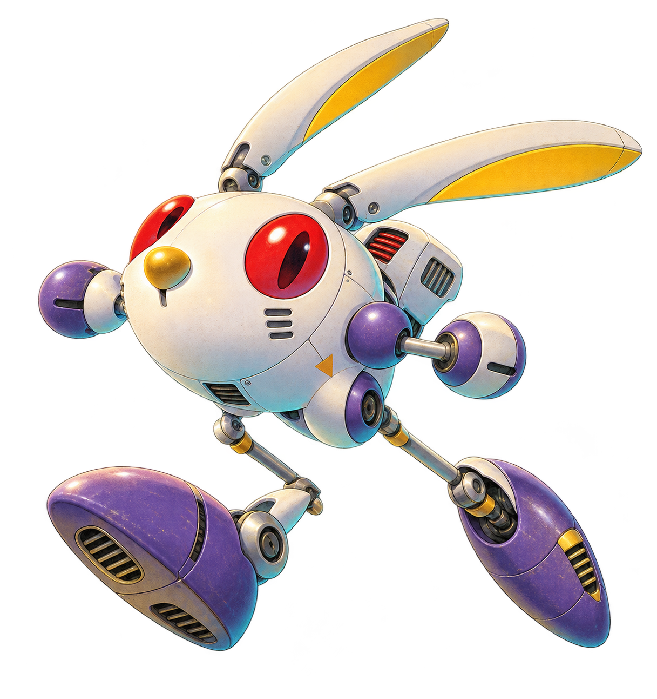
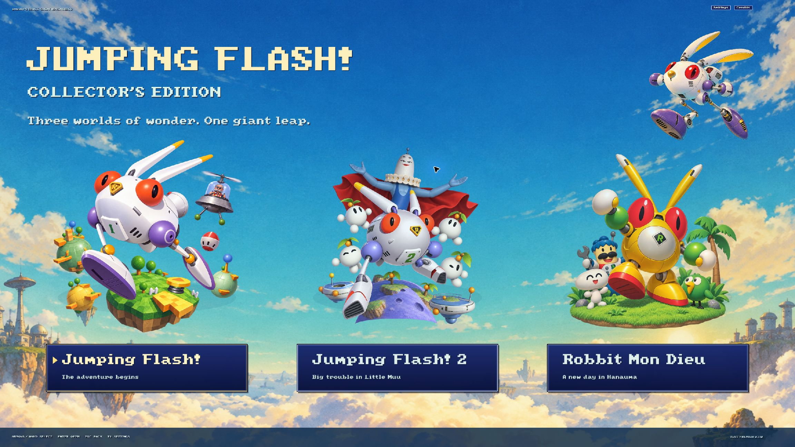
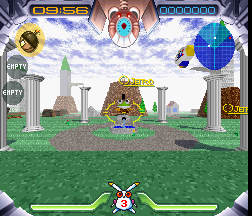
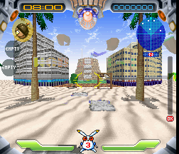
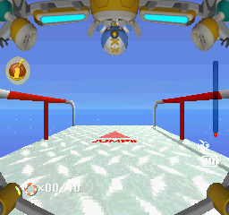
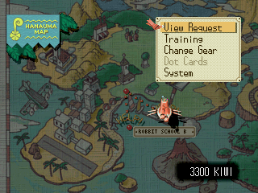
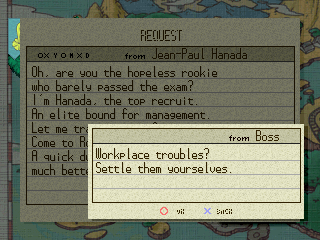

  

<h1 align="center">Jumping Flash! Collector's Edition</h1>

<strong>Three adventures. One collection. A new leap onto PC.</strong>

  
  
  
  

  <a href="#the-collection">The games</a> · <a href="#where-it-stands">Status</a> ·
  <a href="docs/PERFORMANCE.md">Benchmarks</a> · <a href="docs/STEAM-DECK.md">Steam Deck</a> ·
  <a href="RELEASE_NOTES.md">Alpha notes</a> · <a href="https://github.com/BluePointDigital/jumping-flash-collection/issues/new/choose">Report an issue</a>

A fan-made native recompilation collection bringing **Jumping Flash!**, **Jumping Flash! 2**, and **Robbit Mon Dieu** together with a controller-friendly launcher, modern control hooks, separate saves, and a presentation inspired by the original PlayStation era.

> **Public source preview.** A private Windows alpha is assembled and undergoing owner testing. This repository contains integration sources and development tools, **not a ready-to-play public game download**. Clean user-side generation of the complete alpha is not yet packaged as a self-contained workflow. No discs, BIOS files, generated game code, or compiled game runtimes are included. See [build status](docs/BUILDING.md) and [distribution boundaries](docs/DISTRIBUTION.md).

## The collection

  

*The collection's opening game-selection screen, captured on Windows.*

| Jumping Flash! | Jumping Flash! 2 | Robbit Mon Dieu |
|:---:|:---:|:---:|
|  |  |  |
| **The adventure begins** | **Big trouble in Little Muu** | **A new day in Hanauma** |
| USA · SCUS-94103 | Europe / PAL · SCES-00111 | Japan · SCPS-10103 |

*Actual guest-frame captures from the Windows alpha tests, displayed here at a larger size. They are not Steam Deck screenshots or evidence of final display resolution. [Screenshot provenance](docs/media/provenance.json).*

## Robbit Mon Dieu, in English

Explore Hanauma and read its requests, menus, and character dialogue in English with **washingtonxan's fan translation**. The original [Robbit Mon Dieu English translation patch](https://romhackplaza.org/translations/robbit-mon-dieu-english-translation-playstation/) is credited to washingtonxan; this collection integrates that work and does not claim authorship of the translation.

| English menus | English dialogue |
|:---:|:---:|
|  |  |

*Actual Windows test captures from the translated build, enlarged for readability. Japanese voices remain. The translation patch is not bundled in this source preview. [Translation and credits](https://romhackplaza.org/translations/robbit-mon-dieu-english-translation-playstation/) · [Screenshot provenance](docs/media/provenance.json).*

## Built for another jump

- **One collection:** title-specific illustrated selections, game introductions, settings, gallery support, and credits.
- **Modern control hooks:** mouse/keyboard and twin-stick mappings, sensitivity, deadzones, inversion, and rebinding support. Broader physical-device testing is ongoing.
- **Original progress:** the games' normal save/load flows, with isolated per-game storage and optional copying of existing cards.
- **Console-style presentation:** PS1-inspired fonts and menus, with a Return to Collection action.
- **Robbit in English:** the private alpha integrates washingtonxan's English fan translation; original Japanese voices remain. The patch is not bundled in this source preview.
- **Original timing:** NTSC timing for JF1/Robbit and PAL timing for the supported JF2 release. Faster rendering must not speed up gameplay.

**Original 4:3 is the default for all three games.** Experimental widescreen is off by default and deferred. Completing it does not block the initial release.

## Where it stands

| Area | Current evidence |
|---|---|
| Windows alpha | All three games passed short packaged Load/gameplay/movement/native-exit checks |
| Static execution | Zero interpreter or runtime-compiler attempts on those observed routes; whole campaigns remain unproven |
| Normal saves | Bounded save/reload routes tested; Robbit School B was later cleared and its two-request progress restored in a fresh process |
| Steam Deck | Owner reports JF2 playable on an original LCD 64 GB Deck with Proton Experimental; graphical glitches, slowdowns, and choppy menu voiceover remain |
| Smooth 60 FPS | Target remains open; internal counters are not physical display FPS |
| Complete campaigns and endings | Not yet qualified |
| Native Linux / Android | Future work; not released or qualified |

On an original LCD 64 GB Steam Deck using **Proton Experimental**, the owner reports JF2 running and playable, with graphical glitches and slowdowns. Menu voiceover is very choppy, then generally smooths out after a little gameplay. Windows feels better overall in the owner's comparison. These are subjective observations; no matched frame-time measurements or controlled comparison between Proton versions has been completed. Proton version may be a factor, but the cause has not been established.

This is **early hardware feedback**, not a verified compatibility rating. The exact Proton Experimental build, rendering/power settings, measured FPS, sleep/resume, and full controller coverage remain unreported.

## A look at performance

Short Windows alpha samples used 720-line internal rendering, 4:3, and the packaged settings. The actual desktop fullscreen output was **2880 × 1620**. Each game was sampled for approximately 20 seconds after a brief load/movement route.

| Game | Guest counter / second | Completed internal swaps / second | Added audio underrun frames |
|---|---:|---:|---:|
| Jumping Flash! | 60.16 | 60.16 | 0 |
| Jumping Flash! 2, PAL | 50.04 | 33.59 | 0 |
| Robbit Mon Dieu | 60.17 | 60.12 | 0 |

**These numbers are not a 60 FPS certification.** Guest counters measure emulated timing; swap counters measure internal presentation calls. JF2 can intentionally skip unchanged images. Distinct rendered frames, interpolation quality, physical display FPS, long-run stability, and Deck performance remain separate questions. Zero underruns in these short samples does not resolve the intermittent JF2 audio issue seen elsewhere.

[Read the benchmark methodology and limitations →](docs/PERFORMANCE.md)

## Trying it / building it

This public snapshot is for source review and development. **There is no public playable binary attached to this source preview.** The private owner-test ZIP is intentionally excluded because it contains imported proprietary material and translated game/BIOS code.

You will need your own supported game images and matching BIOS files for local game preparation. No ROM or BIOS downloads are provided. The source tree preserves the integration work, but the complete source-generation/build chain still depends on private development inputs; the remaining work is documented rather than presented as a one-click installer.

- [Build prerequisites and current limitations](docs/BUILDING.md)
- [Supported revisions and inputs](docs/INPUTS.md)
- [Steam Deck owner-test guidance](docs/STEAM-DECK.md)
- [Known issues](docs/KNOWN-ISSUES.md)
- [Contributing and useful bug reports](CONTRIBUTING.md)

## What is being recompiled?

The original PlayStation machine code is translated into C and compiled with a PSXRecomp-based runtime. This is not a reconstruction of the entire game into clean, named gameplay source. Graphics, audio, timing, memory, and console services still need runtime support. Modding interfaces and clearer game-specific APIs remain opportunities for future work.

## Credits and licensing

Original games and characters belong to their respective rights holders. This is an independent fan project and is not affiliated with or endorsed by Sony, Exact, Sugar & Rockets, or the referenced port teams.

- **PSXRecomp / RetroPortingToolKit:** native recompilation framework and runtime.
- **recomp-ui, SDL3, Dear ImGui, stb_image, toml11:** UI and platform foundations.
- **washingtonxan:** Robbit Mon Dieu English fan translation. [Translation page](https://romhackplaza.org/translations/robbit-mon-dieu-english-translation-playstation/).
- **Dusklight, Ship of Harkinian, Zelda64Recomp, OpenGOAL:** inspiration for presentation and integration; these teams do not maintain this project.
- Collection illustrations are AI-generated fan artwork. Provenance is preserved with the artwork files.

Licenses are component-specific. **The framework is PolyForm Noncommercial; a project MIT notice does not override that license.** Screenshots and character artwork are not licensed as game assets by this repository. See [THIRD_PARTY.md](THIRD_PARTY.md), [ASSET-NOTICE.md](ASSET-NOTICE.md), and [LICENSES/](LICENSES/).
